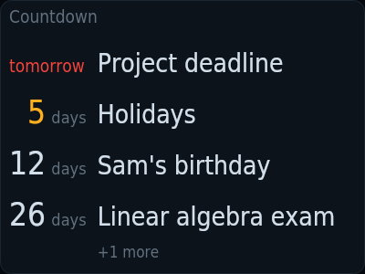
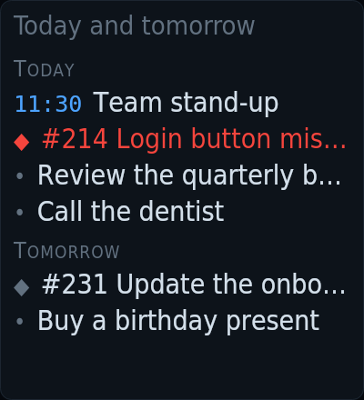
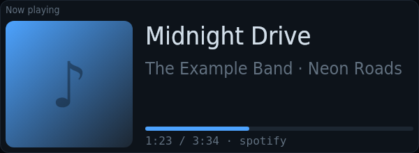
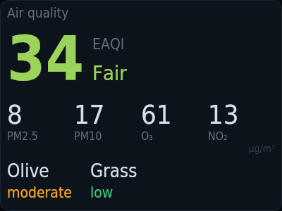
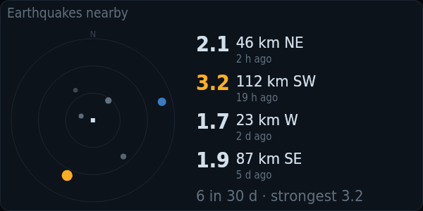
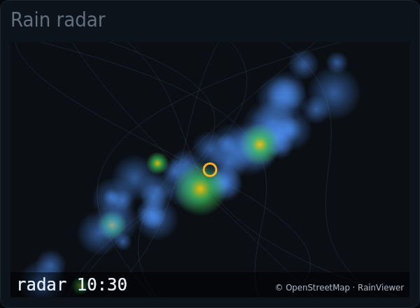

# kiosko-plugin-mirror

MagicMirror²-style cards: countdown, compliments, today and tomorrow, now playing, on this day, air quality, earthquakes and rain radar.

A plugin for [Kiosko](https://github.com/kiosko-lcd/kiosko), the widget mosaic for small USB LCD panels.



## Install

In Kiosko, **Plugins → Install from npm** → `kiosko-plugin-mirror`, then restart Kiosko. Or from a terminal:

```sh
npm install --prefix ~/.config/kiosko/plugins kiosko-plugin-mirror
```

(macOS: `~/Library/Application Support/Kiosko/plugins`, Windows: `%APPDATA%\Kiosko\plugins`.)

## Requirements

- Location in Kiosko → Settings for air quality, earthquakes and the rain radar. *Now playing* reads MPRIS (Linux).

## Widgets

### Countdown — `mirror/countdown`

Days left until your important dates, nearest first.


| Option | Type | Default | |
|---|---|---|---|
| `events` | list | `[]` | Dates. Past dates hide themselves. |
| `max` | number | `4` | How many to show |

### Compliments — `mirror/compliments`

A phrase that suits the time of day, like the MagicMirror² classic.


| Option | Type | Default | |
|---|---|---|---|
| `morning` | list | `[]` | Morning (3–12 h). Leave every list empty to use the built-in phrases, in your language. |
| `afternoon` | list | `[]` | Afternoon (12–17 h). Leave every list empty to use the built-in phrases, in your language. |
| `evening` | list | `[]` | Evening and night. Leave every list empty to use the built-in phrases, in your language. |
| `anytime` | list | `[]` | Any time. Leave every list empty to use the built-in phrases, in your language. |
| `changeMs` | duration (ms) | `1800000` | Change every |
| `maxSize` | number | `56` | Largest letter size |
| `align` | `left` \| `center` | `"left"` | Alignment |

### Today and tomorrow — `mirror/tasks`

Your to-dos for today and tomorrow, from a Markdown checklist and, optionally, your GitLab issues.



| Option | Type | Default | |
|---|---|---|---|
| `file` | string | `"~/tasks.md"` | Checklist file. Markdown with "- [ ] …" boxes under "## Today" and "## Tomorrow"; "@2026-10-14" dates a box. |
| `gitlab` | boolean | `false` | Add my GitLab issues with a due date |
| `bin` | string | `"glab"` | glab command. The GitLab CLI, already logged in. |

### Now playing — `mirror/nowplaying`

The song playing on this computer (any MPRIS player on Linux: Spotify, browser, VLC…), with cover and progress. Hidden while nothing plays.



| Option | Type | Default | |
|---|---|---|---|
| `showPaused` | boolean | `false` | Also while paused |
| `prefer` | string | `""` | Preferred player. Part of its MPRIS name; empty = whichever plays. |
| `cover` | boolean | `true` | Show the cover |

### On this day — `mirror/onthisday`

Selected anniversaries of today from Wikipedia, one at a time.


| Option | Type | Default | |
|---|---|---|---|
| `lang` | string | `""` | Wikipedia language. A code such as en, es, de; empty = yours. Not every edition has this feed. |
| `changeMs` | duration (ms) | `600000` | Change every |

### Air quality — `mirror/airquality`

European air quality index, particles, gases and pollen where you are (Open-Meteo).



| Option | Type | Default | |
|---|---|---|---|
| `pollen` | boolean | `true` | Show pollen |
| `latitude` | number | `0` | Latitude. Leave latitude and longitude at 0 to use the place set in Settings. |
| `longitude` | number | `0` | Longitude |

### Earthquakes nearby — `mirror/earthquakes`

Recent earthquakes around you (EMSC) on a polar map, with magnitude, place and time. Hidden when there are none.



| Option | Type | Default | |
|---|---|---|---|
| `radiusKm` | number | `150` | Radius |
| `days` | number | `30` | Days back |
| `minMagnitude` | number | `1.5` | Minimum magnitude |
| `rows` | number | `4` | Rows in the list |
| `latitude` | number | `0` | Latitude. Leave latitude and longitude at 0 to use the place set in Settings. |
| `longitude` | number | `0` | Longitude |

### Rain radar — `mirror/rainmap`

Latest rain radar (RainViewer) over a dark OpenStreetMap map, home in the centre. By default only shows while it rains nearby.



| Option | Type | Default | |
|---|---|---|---|
| `onlyWhenRaining` | boolean | `true` | Only while it rains nearby |
| `latitude` | number | `0` | Latitude. Leave latitude and longitude at 0 to use the place set in Settings. |
| `longitude` | number | `0` | Longitude |

## Development

```sh
npm install
npm test          # node:test
npm run check     # TypeScript
npm run build     # dist/index.js, what Kiosko loads
```

To try it in a running Kiosko without publishing: `kiosko plugins link .` and restart Kiosko.

Working on Kiosko and its plugins together: clone them side by side
(`kiosko/` and `kiosko-plugins/kiosko-plugin-mirror/`) and run `npm install` in
`kiosko/`; its workspaces link every plugin found in `../kiosko-plugins`.

## License

MIT
